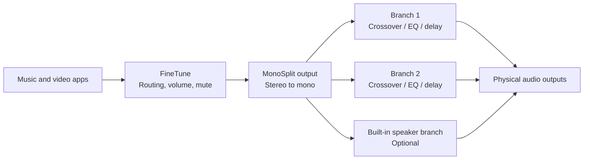

# MonoSplit

**Tune the speaker branches. Let FineTune handle everyday playback.**

MonoSplit is an independent macOS menu bar app for mono crossovers and speaker tuning. It mixes stereo into mono, then sends that signal through three independently adjustable branches, each with its own crossover, parametric EQ, level, polarity and delay. You can also expose the whole setup as one output inside [FineTune Sync](https://github.com/wait2050/FineTune-Sync), which handles application routing and everyday volume.

<br clear="all" />

[Download for macOS](https://github.com/wait2050/MonoSplit/releases/latest) · [简体中文](README.md) · [Integration guide](Integration/FineTune-Integration.md) · [Report an issue](https://github.com/wait2050/MonoSplit/issues)

  

## How MonoSplit and FineTune work together

MonoSplit keeps its own process, tuning window and speaker profiles. Integration adds it to **FineTune’s own output-device list**, without installing a system audio driver.



| Task | Where to do it |
| --- | --- |
| Application routing, per-app level, master volume and mute | FineTune Sync |
| Crossovers, REW filters, EQ, polarity and branch delay | MonoSplit |
| Save, import and switch complete speaker profiles | MonoSplit |
| Process system audio independently of FineTune | MonoSplit’s system-audio input mode |

The input is mixed as `(L + R) / 2`. The UI labels “left” and “right” identify two output branches fed by the same mono mix. This is intended for mono multiway speaker tuning and active crossovers.

## Features

- **Three independent branches:** two general output branches plus an optional built-in speaker branch, assigned by device UID and physical channel number.
- **Crossovers:** Butterworth 12 / 24 / 48 dB/oct and Linkwitz–Riley 24 / 48 dB/oct, with separate high-pass and low-pass switches.
- **Up to 20 parametric filters per branch:** peaking, low-shelf, high-shelf and second-order high/low-pass filters, with graphic sliders and precise parameter editing.
- **Timing and levels:** 0–2000 ms delay per branch, polarity inversion, gain, preamp, mute and solo; a shared peak limiter.
- **REW import:** Generic / Equalizer APO-compatible filter text and measurement curves, with magnitude and phase views.
- **Profiles and presets:** complete speaker profiles, named EQ presets, JSON import/export, autosave, backup recovery, undo/redo and tuning snapshot comparison.
- **Independent native app:** a Rust + GPUI frontend, a Swift / Core Audio host and C++ DSP, with audio rendering separated from the UI.

## Download and setup

Prebuilt releases require an **Apple Silicon Mac running macOS 15.4 or later**. MonoSplit’s current UI is primarily Simplified Chinese; this repository provides both Chinese and English documentation. FineTune Sync has Chinese and English UI.

### Use it with FineTune

1. Download [MonoSplit](https://github.com/wait2050/MonoSplit/releases/latest) and [FineTune Sync with MonoSplit support](https://github.com/wait2050/FineTune-Sync/releases/latest). Unzip and open the apps. Quit an older copy before replacing it.
2. Assign physical output devices and channels in MonoSplit, and check the master level.
3. In MonoSplit’s menu bar menu, enable **“FineTune 输入（作为独立设备）”** (FineTune input, as an independent device), then click **“启动处理”** (Start processing).
4. Open FineTune and select **MonoSplit** in its output list or an application’s output picker. The open button beside the device brings up MonoSplit’s tuning window.
5. Use FineTune for everyday volume and MonoSplit for speaker tuning. Apps explicitly pinned to older physical outputs need to be switched to MonoSplit individually.

The logical output exists inside FineTune. System alerts, ignored apps and uncaptured audio continue through their existing paths. For speakers already managed inside MonoSplit, select the single MonoSplit route in FineTune.

### Use it independently

Quit FineTune, disable “FineTune 输入” in MonoSplit’s menu, select physical outputs and start processing. Grant system audio recording permission when macOS requests it. Closing the tuning window keeps the menu bar app running. Processing starts stopped on every app launch.

Downloads use local ad-hoc signing and are not Apple-notarized. Follow macOS’s app-opening prompts on first launch. Intel prebuilt releases are not provided.

## Timing and hardware

The FineTune bridge uses approximately **40 ms of preroll buffering**, in addition to callback blocks, device latency and any branch delay. Recheck alignment when playing alongside other speakers; 40 ms is not a measurement of total latency. Bluetooth reconnections and sample-rate changes can also affect timing.

The shared-memory bridge gives each renderer an independent track, supporting up to 64 concurrent tracks on the same physical clock and sample rate. The bridge’s audio callbacks perform no file/network I/O, allocation or locking. Stopping or quitting MonoSplit removes the logical device from FineTune, which applies its existing disconnect fallback.

Independent control of three amplifier outputs requires corresponding independently addressable hardware channels and wiring. A SUB terminal on a two-input amplifier does not necessarily provide a separately controllable software channel.

## Build from source

Use Xcode, Swift 6, and Rust / Cargo with Rust 2024 edition support. Verified locally with Rust 1.94.1, Swift 6.3.3 and Xcode 26.6; the deployment target is macOS 15.4.

```sh
git clone https://github.com/wait2050/MonoSplit.git
cd MonoSplit
./scripts/build-finetune-bridge-app.sh
```

The result is `build/MonoSplitFineTune.app`, containing independent and FineTune input modes. FineTune builds separately in [its own repository](https://github.com/wait2050/FineTune-Sync). Neither application links the other application or its DSP library.

```sh
swift test
./scripts/check-pcm-bridge.sh
./scripts/check-gpui-bridge.sh
cargo test --manifest-path gpui/Cargo.toml --locked
```

The SwiftUI frontend is retained under `Sources/MonoSplit` and can be built with `scripts/build-app.sh`. Main directories: `gpui/` for the UI, `Sources/MonoSplitCore` for profiles and filter math, `Sources/MonoSplitDSP` for DSP and PCM transport, and `Integration/` for integration documentation and hardware checks.

## Settings and validation

Profiles and EQ presets live in `~/Library/Application Support/MonoSplitGPUI/`. Bridge sessions live in `~/Library/Application Support/MonoSplitBridge/`; the current session is removed on stop. Speaker profiles retain device UIDs, crossovers, EQ, gains, polarity, delays and measurement references.

The [validation record](Verification/VALIDATION.md) describes automated tests and real-audio checks. Long listening sessions over Bluetooth and acoustic alignment on other hardware still need verification.

## License

**Original project code and documentation use [0BSD](LICENSE).** You may use, copy, modify, sell and redistribute them for any purpose, including incorporation into closed-source software. The original portions require no attribution, publication of modifications or license fee. The software is provided as is.

Dependencies retain their own terms; see [third-party notices](THIRD_PARTY_NOTICES.md). GPUI and gpui-component are Apache-2.0. **FineTune Sync is a separate derivative of a GPL-3.0 project and retains its GPL-3.0 requirements.** MonoSplit’s 0BSD license does not replace licenses on FineTune or other dependencies.

Thanks to [GPUI](https://github.com/zed-industries/zed), [gpui-component](https://github.com/longbridge/gpui-component), [FineTune](https://github.com/ronitsingh10/FineTune) and [REW](https://www.roomeqwizard.com/).
