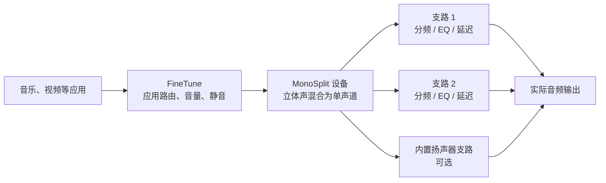

# MonoSplit

**一套音箱，分路调好；日常音量，交给 FineTune。**

MonoSplit 是独立的 macOS 菜单栏单声道分频与调音应用。它把立体声混为单声道，再送入三条独立处理支路，让每一路都有自己的分频、参数 EQ、音量、极性和延迟。也可以把整套 MonoSplit 作为 [FineTune Sync](https://github.com/wait2050/FineTune-Sync) 中的一台输出设备，由 FineTune 管理应用路由和日常音量。

<br clear="all" />

[下载 macOS 版](https://github.com/wait2050/MonoSplit/releases/latest) · [English](README.en.md) · [联动指南](Integration/FineTune接入说明.md) · [报告问题](https://github.com/wait2050/MonoSplit/issues)

  

## MonoSplit 和 FineTune 怎样分工？

MonoSplit 始终保留独立进程、调音窗口和音箱配置。接入 FineTune 后，它出现在 **FineTune 内部的设备列表**，无需安装系统音频驱动。



| 日常要做的事 | 在哪里调整 |
| --- | --- |
| 某个应用去哪个设备、应用音量、整体音量、静音 | FineTune Sync |
| 三路输出的分频、REW 参数、EQ、极性和延迟 | MonoSplit |
| 保存、导入和切换整套音箱配置 | MonoSplit |
| 暂时离开 FineTune，独立处理系统声音 | MonoSplit 的系统音频输入模式 |

输入按 `(L + R) / 2` 混合。界面中的“左声道”“右声道”是两条独立输出支路的名称，声音均来自同一单声道混合信号，适合分频音箱与单声道多路调音。

## 能调什么？

- **三路独立处理**：两条通用输出支路，加一条可关闭的内置扬声器支路；按设备 UID 和物理输出通道分配。
- **分频**：Butterworth 12 / 24 / 48 dB/oct，Linkwitz–Riley 24 / 48 dB/oct，高通和低通可独立开关。
- **每路最多 20 段参数 EQ**：峰值、低架、高架及二阶高低通；支持图示滑杆和精确参数编辑。
- **延迟与电平**：每路 0–2000 ms 延迟、极性反转、音量、前级、静音和独听；共享峰值限制器。
- **REW 导入**：读取 Generic / Equalizer APO 兼容滤波器文本和测量曲线，叠加查看频响与相位。
- **配置与预设**：整套音箱配置、命名 EQ 预设、JSON 导入导出、自动保存、备份恢复、撤销重做和调音快照对比。
- **独立窗口**：Rust + GPUI 界面，Swift / Core Audio 宿主和 C++ DSP；音频回调与界面分离。

## 下载与开始

发布包适用于 **Apple Silicon Mac，macOS 15.4 或更新版本**。MonoSplit 当前界面以简体中文为主；本仓库提供中英文说明。FineTune Sync 支持中文和英文界面。

### 与 FineTune 一起使用

1. 下载 [MonoSplit](https://github.com/wait2050/MonoSplit/releases/latest) 和 [支持联动的 FineTune Sync](https://github.com/wait2050/FineTune-Sync/releases/latest)。解压后打开应用；替换旧版本前先退出它。
2. 在 MonoSplit 中配置每条支路的实际输出设备及通道，确认总音量。
3. 点击 MonoSplit 菜单栏图标，勾选 **“FineTune 输入（作为独立设备）”**，再点击 **“启动处理”**。
4. 打开 FineTune，在输出列表或应用的输出选择器中选择 **MonoSplit**。设备旁的打开按钮可显示 MonoSplit 调音窗口。
5. 在 FineTune 调日常音量，在 MonoSplit 调音箱。以前明确指定了物理设备的应用，需要单独把输出切到 MonoSplit。

这台逻辑设备只出现在 FineTune 内。系统提示音、FineTune 忽略的应用和未被接管的声音仍沿原路径播放。MonoSplit 内已经管理的扬声器，在 FineTune 中选择 MonoSplit 这一条路径即可。

### 独立使用

退出 FineTune，在 MonoSplit 菜单中关闭“FineTune 输入”，选择物理输出并启动处理。首次使用时，按 macOS 提示允许系统音频录制。关闭窗口后，应用继续留在菜单栏；音频处理每次启动应用时都从停止状态开始。

发布包使用本地 ad-hoc 签名，未经过 Apple 公证；首次打开需按 macOS 的应用打开提示操作。仓库不提供 Intel 预编译包。

## 延迟与设备说明

FineTune 桥接使用约 **40 ms 预缓冲**，另有音频回调块、设备本身和各支路设置的延迟。与其他音箱合播时，应重新检查同步；该数字不是对总延迟的测量。蓝牙重连和采样率切换也可能影响时序。

共享内存桥接按应用建立独立轨道，最多同时容纳 64 个渲染轨道，使用相同的物理时钟和采样率。音频回调不进行文件或网络读写、内存分配及加锁。停止或退出 MonoSplit 后，FineTune 将移除该设备并采用自身的断开回退策略。

独立控制三条功放输出，需要硬件向 Mac 暴露相应的独立输出通道和接线路径。只有两个输入通道的功放，其 SUB 接线端子不一定能由软件单独调节。

## 从源码构建

需要 Xcode、Swift 6，以及支持 Rust 2024 edition 的 Rust / Cargo。已验证工具链为 Rust 1.94.1、Swift 6.3.3、Xcode 26.6；构建目标最低为 macOS 15.4。

```sh
git clone https://github.com/wait2050/MonoSplit.git
cd MonoSplit
./scripts/build-finetune-bridge-app.sh
```

输出为 `build/MonoSplitFineTune.app`，包含独立模式与 FineTune 输入模式。FineTune 在[自己的仓库](https://github.com/wait2050/FineTune-Sync)中独立构建，双方无需链接彼此的应用或 DSP 库。

```sh
swift test
./scripts/check-pcm-bridge.sh
./scripts/check-gpui-bridge.sh
cargo test --manifest-path gpui/Cargo.toml --locked
```

SwiftUI 前端也保留在 `Sources/MonoSplit`，可用 `scripts/build-app.sh` 构建。主要目录：`gpui/` 为界面，`Sources/MonoSplitCore` 为配置与滤波器数学，`Sources/MonoSplitDSP` 为 DSP 及桥接，`Integration/` 为联动文档与硬件检查。

## 配置与验证

音箱配置和 EQ 预设保存在 `~/Library/Application Support/MonoSplitGPUI/`。桥接会话位于 `~/Library/Application Support/MonoSplitBridge/`，停止时清除当前会话。音箱配置按设备 UID 保存，包含分频、EQ、增益、极性、延迟和测量参考。

[验证记录](Verification/VALIDATION.md)说明自动测试和实际音频检查的范围。长时间蓝牙试听和不同硬件上的声学对齐仍需使用者验证。

## 开源许可

**本项目自有代码和文档使用 [0BSD](LICENSE)**：允许任何目的的使用、复制、修改、商用和再发布，也允许闭源再利用；自有部分不要求署名或回传修改，不收取许可费用。软件按现状提供。

第三方依赖保留各自的许可，详见 [第三方声明](THIRD_PARTY_NOTICES.md)。GPUI 和 gpui-component 使用 Apache-2.0。独立运行的 **FineTune Sync 是 GPL-3.0 项目的衍生版，继续适用其 GPL-3.0 条件**；本项目的 0BSD 不会改变 FineTune 或其他依赖的许可证。

感谢 [GPUI](https://github.com/zed-industries/zed)、[gpui-component](https://github.com/longbridge/gpui-component)、[FineTune](https://github.com/ronitsingh10/FineTune) 和 [REW](https://www.roomeqwizard.com/)。
